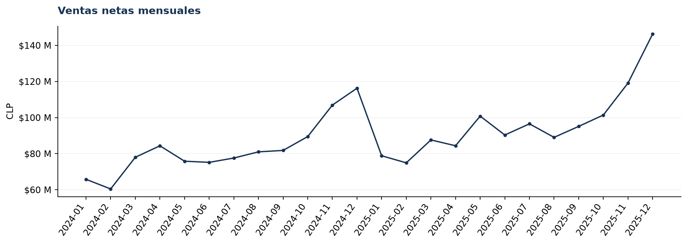
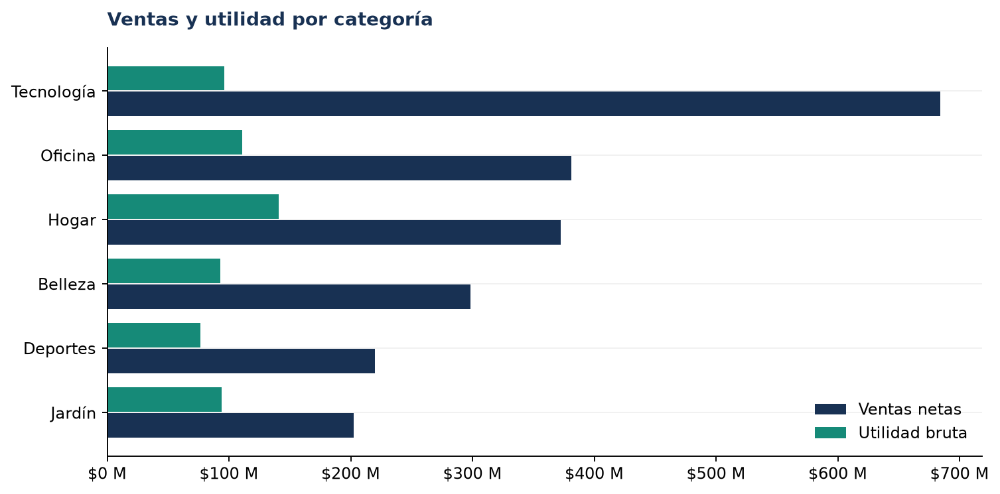

# Análisis de Ventas y Rentabilidad

**Business Sales Analytics · Python · Chile · 2024–2025**

Proyecto de portafolio para analizar ventas, utilidad bruta y oportunidades comerciales de un retailer multicanal **simulado**. Incluye un generador reproducible de transacciones, limpieza auditable, KPIs financieros, análisis exploratorio, diez gráficos, notebook ejecutable y pruebas automatizadas. Los datos no representan una empresa real ni experiencia laboral remunerada.

## Problema de negocio y objetivo

La dirección necesita conocer la evolución mensual de ventas, los productos y regiones que aportan ingresos, los segmentos que generan utilidad, el comportamiento de clientes y la posible presión de descuentos sobre el margen. El análisis usa importes reconocidos solo para pedidos completados; cancelaciones y devoluciones se estudian como indicadores operativos.

## Stack

Python 3.11+, Pandas, NumPy, Matplotlib, Jupyter Notebook, pathlib y pytest. No requiere APIs ni servicios pagados.

## Datos y metodología

`src/generar_dataset.py` crea con semilla fija pedidos de enero de 2024 a diciembre de 2025, 36 productos en seis categorías, clientes recurrentes, ocho regiones y tres canales. Introduce duplicados, nulos, formatos inconsistentes y valores inválidos controlados. `src/limpieza.py` normaliza y valida cada línea; el detalle de conteos queda en `data/processed/auditoria_limpieza.json`. El diccionario y las fórmulas están en [reports/diccionario_datos.md](reports/diccionario_datos.md).

**Política financiera:** `descuento_pct` usa escala 0–1. Venta neta = cantidad × precio unitario × (1 − descuento). Utilidad bruta = venta neta − cantidad × costo unitario. Margen agregado = SUM(utilidad bruta) / SUM(venta neta) × 100. Los pedidos cancelados y totalmente devueltos no reconocen ingresos ni costos; las tasas usan pedidos únicos. La utilidad bruta excluye operación, impuestos, logística, marketing e intereses.

## Principales resultados

Resultados calculados desde `data/processed/ventas_clean.csv`:

| Indicador (2024–2025) | Resultado |
|---|---:|
| Ventas netas reconocidas | $2.157.751.210 CLP |
| Utilidad bruta | $611.816.010 CLP |
| Margen bruto global | 28,4% |
| Pedidos completados únicos | 9.307 |
| Ticket promedio por pedido | $231.842 CLP |
| Unidades vendidas | 20.256 |
| Clientes compradores | 1.151 |
| Tasa de cancelación / devolución | 7,0% / 4,2% |

La categoría **Hogar** aporta $140.646.635 CLP de utilidad bruta (margen 37,8%). **Teclado** vende $281.974.260 CLP con un margen de 6,2%, lo que justifica revisar su costo y política de descuento. **Metropolitana** concentra $859.014.535 CLP en ventas y **Online** aporta $967.857.650 CLP. El mayor descenso mensual fue en enero de 2025 (−32,2% frente a diciembre de 2024). El margen observado pasa de 33,0% sin descuento a 4,8% con descuentos superiores a 20%; esta asociación no demuestra causalidad.

El [resumen ejecutivo](reports/resumen_ejecutivo.md) presenta seis hallazgos cuantificados, recomendaciones y KPIs de seguimiento.

## Visualizaciones





Los diez PNG están disponibles en [`reports/figures/`](reports/figures/).

## Estructura

```text
analisis-ventas-rentabilidad/
├── data/raw/ventas_raw.csv
├── data/processed/ventas_clean.csv
├── data/processed/auditoria_limpieza.json
├── notebooks/01_analisis_ventas_rentabilidad.ipynb
├── src/{generar_dataset,limpieza,kpis,visualizaciones,analisis}.py
├── scripts/build_notebook.py
├── reports/{resumen_ejecutivo,diccionario_datos}.md
├── reports/figures/  (10 PNG)
├── tests/
├── requirements.txt
└── .gitignore
```

## Reproducción desde cero (Windows PowerShell)

Abra PowerShell en la raíz de este proyecto. Se recomienda una ruta corta para el entorno virtual en Windows, ya que JupyterLab puede exceder el límite de rutas en carpetas profundas.

```powershell
py -3.11 -m venv C:\va
C:\va\Scripts\python.exe -m pip install -r requirements.txt
C:\va\Scripts\python.exe -m src.generar_dataset
C:\va\Scripts\python.exe -m src.limpieza
C:\va\Scripts\python.exe -m src.analisis
C:\va\Scripts\python.exe scripts\build_notebook.py
C:\va\Scripts\python.exe -m pytest -q
C:\va\Scripts\python.exe scripts\validate.py
C:\va\Scripts\python.exe -m notebook
```

En Jupyter abra `notebooks/01_analisis_ventas_rentabilidad.ipynb` y ejecute **Run All**. El notebook espera que Jupyter se haya iniciado desde la raíz del proyecto. Para ejecutarlo sin interfaz:

```powershell
C:\va\Scripts\python.exe -c "import nbformat; from nbclient import NotebookClient; from pathlib import Path; p=Path('notebooks/01_analisis_ventas_rentabilidad.ipynb'); n=nbformat.read(p,as_version=4); NotebookClient(n,timeout=120,resources={'metadata':{'path':str(Path.cwd())}}).execute(); nbformat.write(n,p)"
```

Con Python 3.13 instalado, cambie solo la primera línea por `py -3.13 -m venv C:\va`. En Linux/macOS, use `python3 -m venv .venv`, active el entorno y ejecute los mismos módulos. El repositorio conserva CSV y PNG para revisión inmediata; los comandos los regeneran.

## KPIs y análisis

Ventas netas, utilidad bruta, margen global, pedidos completados únicos, ticket promedio, unidades, compradores únicos, crecimiento mensual, ventas por región y canal, ventas y utilidad por categoría, top productos y clientes, y tasas de cancelación/devolución. Se comparan años, estacionalidad, recurrencia de clientes y rangos de descuento. Las relaciones entre descuentos y margen son descriptivas; no prueban causalidad.

## Recomendaciones y límites

Las recomendaciones cuantificadas están en el reporte ejecutivo. Antes de aplicar cambios comerciales, validar con datos reales, añadir costos de adquisición y logística, y probar promociones con grupos de control. Los importes son nominales y sintéticos.

## Cómo presentar este proyecto en mi CV

**Descripción breve:** Proyecto independiente de análisis de ventas y rentabilidad de retail chileno con datos sintéticos reproducibles, desde limpieza hasta recomendaciones comerciales.

**Tres bullets para CV**

- Construí un pipeline reproducible en Python/Pandas/NumPy para generar, depurar y validar transacciones sintéticas, con auditoría de calidad y pruebas pytest.
- Definí KPIs de ventas, utilidad bruta, margen y comportamiento de pedidos sin duplicar pedidos multilínea ni reconocer ingresos cancelados o devueltos.
- Realicé análisis exploratorio y visualizaciones Matplotlib de tendencias, productos, clientes, regiones, canales y descuentos; traduje hallazgos cuantificados en acciones medibles.

**Descripción técnica para GitHub:** Repositorio modular con generador determinista, limpieza idempotente, cálculos financieros y agregaciones reutilizables, notebook narrativo, reporte ejecutivo, diez gráficos PNG y tests. Python, Pandas, NumPy, Matplotlib y Jupyter.

**Explicación de 30 segundos para entrevista:** “Desarrollé un caso de retail chileno con datos sintéticos para demostrar un flujo completo de análisis. Generé pedidos multilínea y problemas de calidad, construí un pipeline de limpieza auditable, calculé ventas y utilidad bruta solo sobre pedidos completados y comparé productos, regiones, clientes, descuentos y canales. El resultado es un notebook reproducible, diez gráficos y recomendaciones medibles. Dejé explícitas las limitaciones: son datos simulados y no se modelan todos los gastos.”

## Publicación

El proyecto está preparado para GitHub, pero no incluye un enlace inventado ni se ha publicado automáticamente. Inicialice Git dentro de esta carpeta, revise los archivos y configure su propio remoto cuando decida publicarlo.
