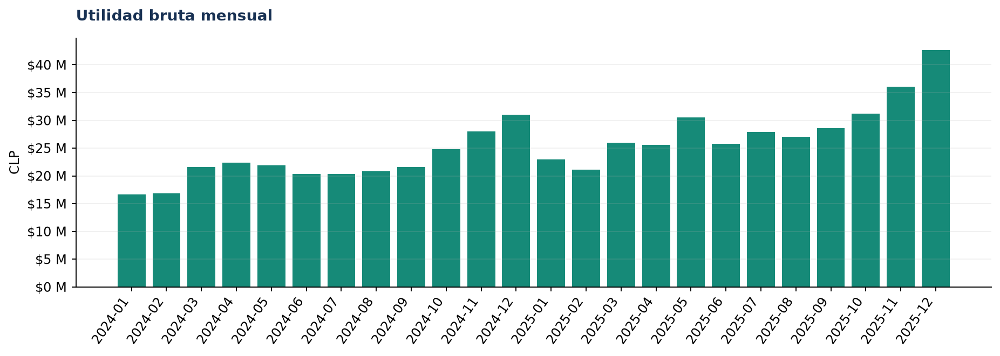
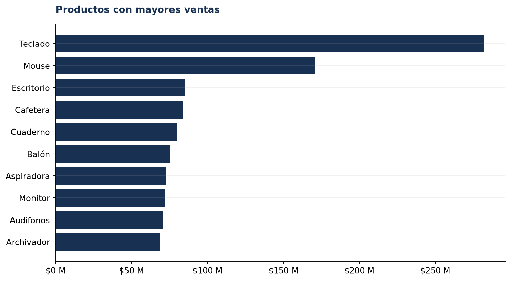

# Resumen ejecutivo | Business Sales Analytics

## Contexto y objetivo

Caso de retail/e-commerce **enteramente sintético** en regiones de Chile, de enero de 2024 a diciembre de 2025. Se evalúan ventas reconocidas, utilidad bruta y oportunidades comerciales.

## Metodología

Se generaron pedidos y líneas con semilla fija. Se eliminaron duplicados y registros inválidos, se normalizaron categorías y se excluyeron pedidos cancelados y devueltos de ingresos y costos reconocidos. Las tasas operacionales usan pedidos únicos.

## KPIs principales

| Indicador | Valor |
|---|---:|
| Ventas netas | $2.157.751.210 CLP |
| Utilidad bruta | $611.816.010 CLP |
| Margen bruto global | 28,4% |
| Pedidos completados únicos | 9,307 |
| Ticket promedio | $231.842 CLP |
| Unidades vendidas | 20,256 |
| Clientes compradores | 1,151 |
| Cancelación / devolución | 7,0% / 4,2% |

## Hallazgos priorizados y decisiones

### 1. La categoría Hogar aporta $140.646.635 de utilidad bruta.

**Evidencia:** Margen agregado: 37,8%; ventas: $372.306.435.

**Interpretación y oportunidad:** Priorizar surtido y disponibilidad de esta categoría.

**Seguimiento:** Utilidad bruta y margen por categoría.

### 2. Teclado combina ventas altas con margen de 6,2%.

**Evidencia:** Ventas: $281.974.260; utilidad: $17.535.260.

**Interpretación y oportunidad:** Revisar costo de compra y límites de descuento de este producto.

**Seguimiento:** Margen y utilidad por producto.

### 3. Metropolitana lidera las ventas regionales.

**Evidencia:** Ventas: $859.014.535; utilidad: $243.706.135.

**Interpretación y oportunidad:** Proteger cobertura logística y probar campañas incrementales en otras regiones.

**Seguimiento:** Ventas y utilidad por región.

### 4. Online es el mayor canal por ventas.

**Evidencia:** Ventas: $967.857.650; margen: 28,4%.

**Interpretación y oportunidad:** Comparar costo comercial y adquisición antes de ampliar inversión.

**Seguimiento:** Margen y ventas por canal.

### 5. El mayor descenso mensual ocurrió en 2025-01.

**Evidencia:** Variación frente al mes anterior: -32,2%; ventas: $78.871.790.

**Interpretación y oportunidad:** Investigar mezcla de productos, demanda y calendario promocional.

**Seguimiento:** Crecimiento mensual de ventas.

### 6. Los descuentos altos se asocian con un margen distinto al de ventas sin descuento.

**Evidencia:** Margen sin descuento: 33,0%; con descuento >20%: 4,8%.

**Interpretación y oportunidad:** Probar promociones con grupo de control; esta comparación no demuestra causalidad.

**Seguimiento:** Margen por rango de descuento.

## Gráficos

## Limitaciones y próximos pasos

Datos sintéticos: los patrones no validan demanda real. Utilidad bruta excluye gastos operacionales, impuestos e intereses. No se modelan costos de marketing, logística ni adquisición. Antes de invertir, contrastar con datos reales y experimentos controlados.
